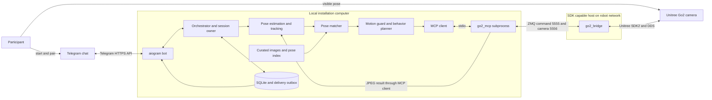

# Robodogo integration and implementation plan

The current [UX contract](UX.md) and [alignment plan](UX_ALIGNMENT_PLAN.md) govern
the encounter and its presentation. The intended setup includes the dog and a
computer connected to a beamer, with the presentation following the main dog
interaction scenario. This earlier plan remains technical integration background;
presentation work and verification are tracked in alignment step 6.

Build on the existing `is_this_us` application. The target experience is: the Go2 notices a
participant, finds a dataset image whose **human pose** resembles theirs, attempts the dog's
pose through a reviewed robot behavior, then sends that same image to the participant's
Telegram chat with a tentative message such as “us?” or “me and who?”. The dog's uncertainty
belongs in its expression; physical execution follows explicit, repeatable rules.

This is the implementation plan for the MCP integration. It does not claim that the proposed
adapters or hardware behavior already work. Baseline: project commit
[`e8e9d97`](https://github.com/ArjunSingh48/ArtHack_Robodogo/tree/e8e9d97e52a4313be66fa47a802c1ad09cea900f),
reviewed 2026-10-24. Upstream robot interface: `go2_main` commit
[`6bca98f`](https://github.com/zhaw-physical-ai/go2_main/tree/6bca98f7144a104b065e73f20aa2b2cd88ebcb3f).

## Decisions for the first working installation

| Area | Decision |
| --- | --- |
| Backend | One local Python application, retaining the existing package, aiogram bot, orchestrator, and SQLite storage. No cloud backend or separate web frontend is needed. |
| Robot connection | A backend-owned MCP client launches `python -m go2_mcp` over stdio. That process connects to the existing ZMQ bridge, which alone owns SDK control. |
| Camera | Start with MCP `get_camera_frame`; add a persistent ZMQ camera subscriber only if measured snapshot latency prevents stable tracking. |
| Human detection | Keep MediaPipe Pose Landmarker and geometric interpretation. Add temporal tracking and normalized landmark similarity. |
| Dataset | Start with the 24 cached artwork images already in the repository. Review a smaller demonstration subset with visible human joints and executable dog poses. |
| Dog imitation | Curate each image into a behavior ID and a tested transition sequence. Preserve an explicit distinction between a close imitation, an approximation, and an unsupported pose. |
| Telegram output | Send the selected dataset image, a short shy caption, and compact artwork credit. The first version does not require a photograph of the robot. |
| Trigger | Prove the flow with `/observe`, then enable automatic triggering when the active participant holds a stable pose. Finding a person means visual detection within the camera view; autonomous roaming is outside this version. |
| Personality | Local, deterministic caption templates. An LLM is optional for annotation suggestions or language variation; it is not required for the demonstration. |
| Hardware rollout | Start with stationary stand, sit, and lowered-body approximations after hardware qualification. Greeting and stretching are later additions. |

“Learning to be a dog” is the artistic framing. The initial implementation retrieves examples
and imitates a fixed vocabulary; feedback may influence future image selection, but does not
train a locomotion policy or change the permitted robot actions.

## What exists and what needs to change

| Existing component | Current behavior in source | Required change |
| --- | --- | --- |
| [Vision](../src/is_this_us/vision/pose.py) | MediaPipe IMAGE mode; up to three people; chooses the largest visible person. | Track one participant over time; retain pose descriptors through matching; handle crops and ambiguous crowds. |
| [Matcher](../src/is_this_us/matching/matcher.py) | Scores coarse posture, gestures, relationships, feasibility, confidence, and novelty. Human posture and relationship each have weight 0.30. | Make human pose similarity the primary criterion. Add explicit missing-joint handling and calibrated rejection. |
| [Dataset](../data/artworks/README.md) | 24 cached images plus human/dog labels and museum provenance. | Add reviewed subject pairs, human landmarks, and robot feasibility for the actual unit. Some existing “held dog → sit” entries are expressive approximations, not pose copies. |
| [Robot interface](../src/is_this_us/robot/base.py) | Synchronous protocol with direct SDK sequences, including `RiseSit`. | Add an MCP adapter and a transport-specific capability profile; do not assume every SDK call is an MCP action. |
| [Motion guard](../src/is_this_us/motion/guard.py) | Arming, stop latch, lock, cooldown, timeout, and a requirement for known battery on real hardware. | Add freshness, capability qualification, and cancellation lifecycle checks. MCP currently lacks required telemetry. |
| [Orchestrator](../src/is_this_us/orchestrator.py) | One capture per installation request; motion precedes notification. | Add stable-pose events, one active participant, durable execution records, and independent delivery retries. `another()` must acquire the same installation lock rather than only inspect it. |
| [Telegram](../src/is_this_us/bot/app.py) | aiogram handlers, pairing, photos, operator controls, memories. | Keep this implementation; simplify the default response and prevent stale callbacks from moving the robot. |
| [Storage](../src/is_this_us/storage.py) | Pairing tokens, coarse observations, memories; several chats can be paired. | Consume pairing tokens atomically, lease the installation to one participant, add an outbox, and remove pending deliveries on `/forget`. |
| [Dialogue](../src/is_this_us/dialogue/engine.py) | EN/RU/DE templates and optional voice. | Add a short caption mode. Voice and longer poems remain optional. |
| Repository setup | README references `.env.example`, `.gitignore`, and `.github/workflows/ci.yml`; these files are absent at the baseline. | Restore the missing setup files and CI in an implementation commit. Replace claims about working CI or fixed test counts with actual checks. |

The [existing architecture](ARCHITECTURE.md) describes the direct SDK prototype. The
[MCP integration contract](MCP_INTEGRATION.md) defines the target connection and the upstream
gaps that must be resolved before real motion.

## Deployment and component connections



The bridge host can be the installation computer if it already has working SDK/network access.
Otherwise keep the bridge on the existing working host and run the application and MCP proxy
on the laptop. Only the bridge needs Unitree SDK2. The laptop needs internet for Telegram and
reachability to the bridge; pose estimation, matching, and cached images remain local.

Keep ports 5555/5556 on the private installation network: the inspected bridge binds to all
interfaces and supplies no application authentication. Run one controller for the installation;
disable competing web-app, CLI, or LLM motion clients during a session. The optional vision
model never receives an MCP session or robot credentials.

Use long polling for the bot, so the laptop needs no public inbound endpoint. Keep blocking
camera and inference work off the bot event loop. A single perception worker owns the
MediaPipe instance, including Telegram photo analysis, so concurrent calls cannot reuse it
unsafely. Maintain only the latest camera frame instead of an accumulating frame queue.

## One interaction from camera to Telegram

1. The operator starts the bridge and application. The application checks MCP capabilities,
   dataset/index integrity, and Telegram configuration while motion remains disarmed.
2. The visitor opens the bot using the operator's short-lived pairing QR. A transaction consumes
   the token and assigns one active installation lease to that chat. The operator identifies
   the participant standing in the marked camera area; there is no facial identity matching.
3. `/observe` requests a fresh capture window. In automatic mode the same window starts after
   the operator opens observation and the active participant remains in the area.
4. The camera worker samples frames, tracks the participant, and emits a `PoseObservation`
   only after a stable pose. Losing the person or seeing competing people resets the window.
5. The matcher compares that person's pose with the annotated **human** in each eligible
   image. It returns the ranked candidates, score components, and a rejection reason if needed.
6. The planner reads the **dog** annotation from the chosen human–dog pair and resolves its
   behavior against the current hardware capability profile. It records any approximation.
7. Immediately before movement, the guard rechecks the session, observation age, stop latch,
   fresh robot state, current body state, and behavior qualification. It persists the execution
   intent, then sends one approved sequence through MCP.
8. Each command result and physical completion evidence are recorded. A timeout means the
   outcome is unknown until reconciled; the application does not automatically repeat motion.
9. In a transaction, the backend records the outcome and queues the image/caption in the
   delivery outbox. Telegram delivery may retry without re-entering the movement stage.
10. After the attempt, wait for a pose change or participant departure and the cooldown before
    another automatic interaction. A sustained pose produces one event, not a stream of posts.

The application state flow becomes:

```text
IDLE -> ACQUIRING -> POSE_STABLE -> MATCHING -> PLANNING -> EXECUTING
     -> OUTCOME_RECORDED -> DELIVERY_QUEUED -> COOLDOWN -> IDLE

No person / weak match -> WAITING_FOR_POSE
Person lost before movement -> CANCELLED
Stop / stale robot state / execution ambiguity -> STOPPED, disarmed
Telegram unavailable -> delivery remains pending; motion is never replayed
```

Initial tuning values: sample at up to 3 Hz, require at least three consistent samples spanning
one second, reject an observation more than two seconds old at dispatch, and retain the existing
eight-second motion cooldown. These are configuration starting points, not measured guarantees.
If MCP capture cannot meet that rate, use the persistent camera subscriber described in the
contract. Suspend triggering during robot movement and reacquire after settling, because the
camera itself has moved.

## Human pose detection and similarity

### Model choice and fallback

Keep the existing MediaPipe implementation for the first release. It supplies 33 landmarks per
person, including visibility/presence information, and supports image, video, and live-stream
modes. Start with sequential IMAGE inference; adopt VIDEO mode with strictly increasing
timestamps if it improves stability on the actual feed. Pin the model artifact and checksum
instead of relying on the current `latest` download URL. See the
[official pose guide](https://developers.google.com/edge/mediapipe/solutions/vision/pose_landmarker/python).

Evaluate the low Go2 camera angle before collecting the demo poses. If the full body cannot fit,
use a marked standing distance or an explicitly selected external camera. Do not treat apparent
body size as a reliable distance measurement for collision avoidance.

An optional vision-language model can propose coarse posture/gesture labels or rank an already
selected shortlist of dataset IDs. Validate its output against a closed schema with confidence
and `unknown`; set a short deadline and fall back to local results. Do not mix model-invented
coordinates into the geometric index. Cloud analysis of participant images is a separate,
explicitly enabled mode. Offline artwork annotation is the preferred first LLM use because it
can be reviewed once and does not add latency to every interaction.

### Pose descriptor and candidate ranking

Implement `vision/descriptors.py` and `matching/pose_similarity.py` with one shared descriptor
version used both offline and live:

1. Preserve pixel aspect ratio when converting normalized coordinates. Use shoulders, elbows,
   wrists, hips, knees, and ankles; exclude facial landmarks from similarity.
2. Subtract the hip midpoint and divide by shoulder-midpoint-to-hip-midpoint torso length.
   Reject a near-zero scale or missing torso anchors for full-body comparison. Preserve torso
   orientation so standing and lying do not become equivalent after rotation.
3. Store normalized 2D joints, visibility masks, torso angle, and available elbow/knee angles.
   Maintain a separate shoulder-anchored upper-body descriptor for cropped people; compare
   only candidates with the same descriptor scope and calibrate it separately.
4. For each candidate, compare only mutually visible joints. Start with visibility >= 0.6 and
   at least eight shared joints including both hips and shoulders for the full-body descriptor.
   Require four shared arm joints plus both shoulders for upper-body comparison. Penalize
   missing coverage; do not replace missing joints with zeros.
5. Compute weighted RMS joint distance in torso-length units and normalized angular distance
   for available limb triplets. Test both the original and a horizontal mirror with left/right
   indices swapped; retain the lower distance and record whether the match was mirrored.

For example, define `Dxy = sqrt(sum(w_j * ||q_j - p_j||²) / sum(w_j))`, with `w_j` the minimum
visibility of the two joints, and `Dangle` the mean absolute angle difference divided by pi.
Start with `D = 0.75 * Dxy + 0.25 * Dangle`; if no valid angles exist, use `Dxy` alone.
Convert to `S_pose = coverage * exp(-D² / (2 * sigma²))`. Fit `sigma`, acceptance threshold,
and runner-up margin on the held-out demonstration examples; this score is not a probability.

First filter to reviewed image pairs with available images and qualified behavior mappings.
Require a passing `S_pose`, then rank by `0.80 * S_pose + 0.15 * gesture_similarity +
0.05 * relationship_similarity`. Use novelty only among candidates within a calibrated pose
tie margin. The relationship score must not rescue a geometrically unrelated pose.

For the earliest vertical slice, retain a clearly labeled coarse mode using the existing human
posture/gesture labels. It can demonstrate the connections before landmark annotation is ready,
but is not evidence of fine pose matching. Never compare unavailable geometric scores against
available ones in the same ranking as though they were equivalent.

Do not select an image merely because every candidate is poor. Low coverage, weak best score,
or ambiguous candidates with different robot behaviors should produce a quiet request such as
“could you hold that for a moment?” and no new motion. Keep scores, method, and rejection reason
in diagnostics; evaluate with fixed seeds and disable random selection in regression tests.

## Dataset preparation and dog imitation

Extend the current curation process rather than replacing museum metadata. Keep
`curation_notes.yaml` as the source for human-reviewed interpretation and preserve
`annotations.yaml` as generated output. Add a versioned `pose_annotations.yaml` sidecar for
subject crops, landmark corrections, selected human–dog pairs, and review records; derive a
small NumPy index from it. A vector database is unnecessary for this collection.

Each indexed record needs:

| Field | Purpose |
| --- | --- |
| `artwork_id`, `pair_id`, image SHA-256 | Bind the pose and dog mapping to an exact image and a specific pair in crowded paintings. |
| `human_bbox`, `dog_bbox` | Normalized image rectangles identifying the reviewed subjects. |
| `human_landmarks`, visibility, descriptor scope | Model output corrected or manually annotated where paintings defeat the detector. Missing joints remain missing. |
| `dog.posture`, requested behavior, fidelity | Preserve the depicted pose separately from the robot approximation. |
| `behavior_profile_id`, review status | Link to a tested motion profile for this robot and firmware; an annotation alone does not qualify a behavior. |
| `model_id`, descriptor version, reviewer, review date | Reproduce preprocessing and invalidate outdated index entries. |

Run the same landmark model offline on the selected human crop and transform its coordinates
back to the full image before normalization. Review an overlay of the resulting skeleton. A
multi-person painting needs an explicit pair selection; never combine one human's pose with
an unrelated dog's annotation. Add photos to fill gaps if the current artworks do not cover
the chosen demonstration poses, retaining source and permission metadata.

Map dog poses to a modest vocabulary:

| Depicted dog | Proposed behavior | Interpretation |
| --- | --- | --- |
| Standing on four legs | `stand` | Match the broad body posture; no attempt to copy position relative to the human. |
| Sitting | `sit` | Use a qualified seated transition. |
| Lying on belly | `lie_down` | Go2 `stand_down` is a lowered-body approximation, to be checked visually. |
| Bowing or stretching | `stretch` | Optional expressive approximation after separate qualification. |
| Raised paw | `greet` | Optional `hello` gesture; not continuous paw tracking. |
| Held in arms, on lap, side-lying, jumping, or obscured | Unsupported in the first motion subset | Stay still or choose another pose-matched, executable example. Do not describe sitting as an exact copy of a held dog. |

A single 2D image does not determine the Go2's joint angles or balance. Exact retargeting would
require a separate 3D reconstruction, kinematic/physics model, trajectory validation, and
hardware-control project. The deliverable here is recognizable imitation using tested built-in
behaviors. Review the existing `reproducible: yes` labels under that definition.

Initial dataset exit criterion: 8–12 reviewed image pairs covering at least standing, sitting,
and crouching/kneeling humans, with at least three visually distinct dog behaviors that the
actual robot can perform. If only two behaviors qualify, narrow the demonstration and report
that limitation instead of labeling untested actions as ready.

## Backend contracts and persistence

Keep existing domain models where their meaning remains correct; add the following fields or
small models. These are proposed contracts, not current APIs.

| Contract | Required information |
| --- | --- |
| `PoseObservation` | UUID, capture/receive times and freshness basis, camera ID, session ID, transient track ID, descriptor version/scope, keypoints/mask, coarse labels, quality. Raw joints stay in memory. |
| `PoseMatch` | Observation ID, dataset version, artwork/pair ID, score components, runner-up margin, mirrored flag, selected dog annotation, rejection/approximation reason. |
| `ExecutionIntent` | UUID, session/observation IDs, behavior-profile version, ordered actions, expected start state, deadline, cancellation generation. Persist before dispatch. |
| `ExecutionOutcome` | Intent ID, per-step SDK codes, `accepted/completed/failed/cancelled/unknown`, completion evidence, duration, final state freshness. `accepted` must not silently map to existing `SUCCESS`. |
| `DeliveryJob` | Unique `(interaction_id, chat_id, message_kind)`, artwork ID, frozen caption, attempt state, next retry, Telegram message ID, expiry. |

Add schema migrations to SQLite rather than silently changing the existing `CREATE TABLE IF
NOT EXISTS` schema. Use transactions for lease acquisition, intent claiming, and outcome/outbox
creation. Keep the existing coarse interaction history; do not persist visitor frames or joint
arrays for normal operation. Artwork landmarks are static dataset content and can be versioned.

The installation lock covers all motion-producing paths, including automatic observations,
`/observe`, and callbacks. Reject busy requests instead of queuing old poses. Inference and
delivery use separate bounded workers. A timed-out execution thread must keep its motion slot
until it has actually stopped; cancelling a future alone does not cancel an SDK call.

On restart, start disarmed, invalidate the active camera track, and mark interrupted motion
intents `unknown`. Reconcile state with the operator before accepting new motion. Only pending
delivery jobs may resume automatically. Use UUIDs for new interaction and execution IDs rather
than the current short random interaction identifiers.

## Telegram flow and personality

Retain aiogram and existing `/start`, `/pair`, `/observe`, `/stop`, `/memory`, and `/forget` flows.
The operator retains `/arm`, `/disarm`, `/status`, `/qr`, `/open`, and `/close`. Operator identity
comes from Telegram `from_user.id`. Restrict installation pairing and control to private chats
for the first release; group membership is not installation authorization.

A QR deep link identifies a session, not a body in the camera. Consume it once, expire it, and
allow only one active participant lease. Renew or release that lease explicitly; after loss of
the tracked person, require reacquisition in the marked area rather than switching silently to
a passerby. Telegram documents the `start` deep-link mechanism in its
[bot features guide](https://core.telegram.org/bots/features#deep-linking).

The default post contains the selected dataset image and one short line:

| Situation | Example caption |
| --- | --- |
| Recognizable attempt | “us?” |
| Tentative invitation | “me and who?” |
| Approximate imitation | “i think this is how dogs do it. us?” |
| Stillness or unsupported pose | “i haven't learned that one yet.” |
| Weak perception | “could you hold that for a moment?” |

Include compact artwork attribution after the line. Avoid claims that the pose succeeded when
only command acceptance is known. Use local templates with a seed and recent-caption history;
if optional LLM phrasing fails, choose a template. The tone is shy and curious without pressuring
the participant to respond.

Upload the cached image using `sendPhoto`; cache the returned `file_id` per bot and image hash.
The API permits an uploaded photo up to 10 MB and captions up to 1024 characters after entity
parsing. Format a short caption safely instead of slicing HTML mid-tag as the current helper
can do. See the [Telegram sendPhoto contract](https://core.telegram.org/bots/api#sendphoto).

Handle delivery in the outbox: respect `retry_after` on rate limits, back off on transient
errors, and stop retrying blocked/invalid chats. A network timeout after upload can mean Telegram
accepted the message; mark delivery `unknown` rather than promising exactly-once delivery.
Do not blindly resend ambiguous jobs. Known failures can retry; an operator can choose to
resend an ambiguous one. No delivery retry repeats robot motion.

“Try another” may retrieve another image from the stored coarse observation, but must not
execute a new physical pose without a fresh capture and active lease. “Keep” stores the artwork
only. `/forget` also releases the lease and cancels pending deliveries. The bot sends artwork
images by default. A photograph showing the robot imitating the pose would require a second
camera, since the Go2's front camera cannot observe its own full body; that is a later feature.

## Implementation sequence and acceptance gates

Work can be split among robot integration, perception/data, and bot/backend owners once the
shared contracts are agreed. These are responsibilities to assign, not claims about staffing.

| Milestone | Concrete changes | Exit evidence |
| --- | --- | --- |
| 0 Reproducible baseline | Restore `.gitignore`, `.env.example`, and CI; install the existing app in a clean environment; run its tests; document actual robot edition, firmware, host, and network. | Mock CLI simulation and dataset validation run from a fresh checkout. Known failures are recorded. No motion required. |
| 1 Read the robot through MCP | Add `robot/mcp_client.py`, `robot/go2_mcp.py`, MCP camera source, configuration, and a read-only diagnostic. Implement strict text/image result decoding. | Actual unit returns a fresh decodable image and action list; disconnects/timeouts return typed failures. Use upstream dummy server only as a transport fixture. |
| 2 Close motion prerequisites | Implement the telemetry/result/transition changes in [MCP_INTEGRATION.md](MCP_INTEGRATION.md), add a qualified profile, and strengthen the guard. | Operator verifies each transition and stop behavior on the unit. Missing/stale telemetry or unsupported actions block motion. |
| 3 Complete the mock experience | Connect one camera request to coarse matching, mock execution, outbox, and a private test chat. Add one-use pairing and the active lease. | One request yields the selected artwork and short caption in the correct chat; retries do not execute motion. |
| 4 Make pose matching precise | Add sidecar schema, preprocessing command, descriptor/index, reviewed overlays, and `matching/pose_similarity.py`. | Held-out poses retrieve curator-approved top-three results in at least 80% of 30 test observations; no-person and low-coverage examples are rejected. Tune before hardware use. |
| 5 Integrate physical imitation | Select MCP backend in bot and CLI factories; use only qualified behaviors; capture execution evidence. | Ten supervised full cycles reach an appropriate behavior and Telegram post, with no unsupported calls or duplicate executions. Record approximations. |
| 6 Add automatic observation | Add `vision/tracker.py` and `observation_loop.py`; stable-pose debounce, freshness, participant loss, cancellation, and cooldown. | A held pose triggers once; leaving and re-entering reacquires; two visitors cannot race for the robot. |
| 7 Rehearse the installation | Exercise camera loss, bridge restart, Telegram outage, blocked chat, stop during every transition, application restart, and `/forget`. | A 30-minute supervised run has no spontaneous re-arming or repeated motion from retries; operator can explain and recover each failure. |

Milestones 1 and 3 can use the existing coarse matcher. Milestone 2 gates all real motion;
milestones 4–6 deliver the intended automatic pose-driven installation. Optional voice, new
languages, model-generated captions, and a second-camera diptych follow the working loop.

### File changes by component

| Component | Existing files to extend | New files to introduce |
| --- | --- | --- |
| Configuration and launch | `config.py`, `cli.py`, `hardware_cli.py`, `bot/app.py`, `pyproject.toml` | `.env.example`, `.gitignore`, dependency lock, actual CI workflow |
| MCP integration | `robot/base.py`, `vision/frame_sources.py`, `motion/guard.py` | `robot/mcp_client.py`, `robot/go2_mcp.py`, versioned robot profile |
| Pose retrieval | `vision/pose.py`, `domain.py`, `matching/matcher.py`, `artworks/curation.py` | `vision/descriptors.py`, `matching/pose_similarity.py`, dataset pose sidecar and index builder |
| Automatic interactions | `orchestrator.py`, `bot/flows.py` | `vision/tracker.py`, `observation_loop.py` |
| Durable delivery | `storage.py`, `notifier.py`, `bot/app.py`, `dialogue/engine.py` | `delivery/outbox.py`, schema migrations |
| Verification | Existing robot, vision, matching, flow, and storage tests | MCP contract fixtures; tracking, cancellation, pose-ranking, and outbox tests |

Paths in this table are relative to `src/is_this_us` unless they name root configuration or data.
Do not replace the direct SDK adapter: retain it as an explicit alternate transport while MCP
becomes the installation path. Never initialize both control transports for the same unit.

### Verification matrix

| Test | Expected result |
| --- | --- |
| No human, cropped torso, low visibility, or two plausible participants | Abstain or reacquire; no physical command. |
| Scaled or translated pose; mirrored arms | Equivalent ranking within tolerance, correct left/right permutation. |
| Same posture with different arm placement | Landmark similarity distinguishes examples beyond the coarse posture label. |
| Unsupported depicted dog pose or unqualified transition | Excluded from motion subset or explicit stillness; no guessed action. |
| MCP text says `OK` but SDK code is nonzero | Execution fails and motion disarms. |
| Missing battery, stale telemetry, bridge restart, unknown body state | Motion remains blocked. |
| Stop during capture, inference, action, or settling | Invalidate pending intent; no subsequent sequence steps; re-arm is explicit. |
| Duplicate update, repeated callback, or simultaneous chats | At most one execution intent is dispatched for the event. |
| Telegram timeout after robot moved | Delivery status changes; robot does not repeat. |
| Crash before or after action dispatch | Restart disarmed; incomplete intent is reconciled, not replayed. |
| Participant photo uploaded remotely | Simulation only, regardless of installation arming. |
| `/forget` with pending notification | Data and queued job removed; no later post from that interaction. |

Measure capture, inference, match, action acceptance, settle/verification, and delivery separately.
Initial performance goals on the chosen laptop/network: pose estimation plus matching p95 under
one second, command acceptance within the configured RPC deadline, and artwork delivery within
five seconds of a recorded outcome when Telegram is reachable. Physical settle times are
measured per behavior; reduce the feature set if the qualified motions cannot fit the demo pace.

## Decisions to resolve at the robot session

Record these answers in a hardware profile before enabling motion: the unit's edition and
firmware; the working bridge host/network interface; who owns the required upstream changes;
which stationary transitions and interruption paths are qualified; whether the front camera
captures the intended poses; and which eight or more dataset pairs best demonstrate them.
Until then, the planned default is camera/matching/Telegram with a mock robot and real motion
disarmed. This lets the team complete most integration work without waiting for hardware time.
