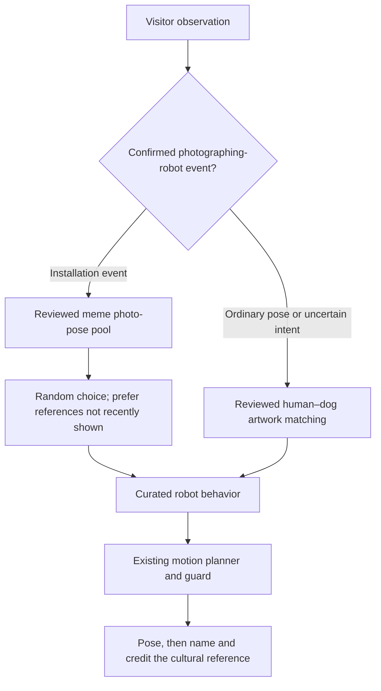

# Meme Memory — the robot discovers internet culture

The robot has two ways to remember cultural dogs. A visitor's body pose invites a
human–dog relationship from an artwork. A visitor photographing the robot invites
it to pose as a randomly chosen meme dog. Solo dogs, cropped portraits, and drawn
dogs belong in this second branch; they do not need a depicted human or a dog
standing on the ground in the source image.

## Two branches



Artwork matching still requires exactly one visible human, one visible dog, and
confirmed ground contact. Its `review` and the meme's `photo_pose` review are
separate. A photo-pose approval never makes a solo-dog meme eligible for ordinary
relationship matching (`art`, `meme`, `both`, or `surprise`).

For a photography event, selection is uniform among eligible memes not recently
shown to this visitor. Once all have been seen, reuse is allowed. The visitor's
posture, gestures, and clothing do not rank the memes. Explicit retry excludes
previous choices in that interaction; if the pool is exhausted or empty, remain
still. The photo branch does not silently substitute a painting. Ordinary `/meme`
requests still use the existing artwork fallback when there are no eligible
human–dog meme scenes.

## Trigger contract and implementation status

`HumanObservation.intent = "photographing_robot"` is an explicit event, handled
only for `origin="installation"`. It takes precedence over the ordinary archive
choice for that interaction. The orchestrator calls
`SceneMatcher.match_photo_opportunity`, then the same motion planner, guard,
dialogue, and delivery path as other scenes. Retries retain the recorded event.
An uploaded Telegram photograph is a different input and never triggers this
branch or real robot motion.

**Implemented:** the separate dataset review, action mappings, random selector,
installation-event routing, persisted intent, and a synthetic rehearsal command:

```bash
itu simulate --photographing --seed 7 --another
itu memes list
itu memes validate
```

**Still to implement:** automatic visual detection of a phone/camera being aimed
at the robot. The current MediaPipe interpreter only estimates body posture and
never emits photography intent. Raised hands, a phone held for reading, a cup,
or a single ambiguous frame are insufficient evidence. The future detector
should combine device visibility, aim toward the robot, and a sustained capture
stance; uncertain evidence stays in the ordinary branch. Emit one event when a
photography attempt begins, then require the device to lower/intent to clear
before rearming. Existing motion cooldown still applies. Detector thresholds,
temporal confirmation, and the rearm latch need on-site validation; the selector
itself is not a continuous-frame detector.

The event does not mean a photo was actually captured. It does not operate the
visitor's camera, store their image, or grant consent for the installation's
optional imitation-photo capture.

## Meme folder review and behavior mapping — 2026-10-24

This is a scenario/mapping review of the **existing annotations and source
descriptions**, not a fresh visual inspection of remote meme images or a hardware
validation. Each record says `review_basis: "existing_annotations"`. All five
curated references qualify for approximate photo poses; all remain
`reference_only`. The draft remains excluded.

| Meme | Camera-facing cue | Requested behavior | Approximation and fallback |
|---|---|---|---|
| Doge | Seated, knowing look toward the lens | `sit` | Seated attitude; no eyebrows, facial recreation, or sofa. |
| Cheems | Compact, calm seated portrait | `sit` | No body-shape or face imitation. |
| This Is Fine | Calm amid absurd surroundings | `sit` | Robot sits on the floor; no chair, cup, smoke, or fire. |
| Side Eye Dog | Sideways glance | `look_aside` | Small body yaw; no independent eye movement. Defaults to `stand` until approved. |
| Long Nose Borzoi | Peering toward the lens | `peer` | Small body pitch; no approach or nose extension. Defaults to `stand` until approved. |
| Buff Doge vs. Cheems (draft) | Two contrasting dogs | excluded | No reviewed single-robot mapping; draft attribution/rights incomplete. |

All five mappings are marked `dog.reproducible: "approximate"`. Three currently
share `sit`; random reference selection will not always produce visibly different
motion. The references and commentary carry part of the distinction. More
expressive movement requires separate reviewed behavior work.

## Annotation schema (one JSON file per meme)

`dog.robot_behavior` remains the sole action mapping. `photo_pose` records why the
cultural reference is suitable and what the robot can approximate:

```json
{
  "human": {"posture": "unknown", "gestures": [], "confidence": 0.0},
  "dog": {
    "posture": "sitting", "relation": "facing_viewer", "interaction": "posing",
    "gaze_at_human": false, "reproducible": "approximate",
    "robot_behavior": "sit", "confidence": 0.8
  },
  "photo_pose": {
    "status": "accepted",
    "cue": "A compact seated dog facing the camera.",
    "approximation": "Sit; body shape and facial expression are not reproduced.",
    "reason": "A stationary seated cultural reference suits a photo opportunity.",
    "reviewer": "Curator name or review process",
    "reviewed_on": "2026-10-24",
    "review_basis": "existing_annotations"
  }
}
```

This fragment supplements the existing identity, source, attribution, image-rights,
reflection, and `curation_status` fields. `photo_pose.status` is `accepted`,
`rejected`, or `needs_review`; missing reviews are ineligible. `review_basis` can
also be `visual_review` after actually inspecting the source. An accepted mapping
requires an approved catalog record, decided image rights, and a reproducible or
approximate action. Unknown-rights drafts and `reproducible: "no"` are excluded.

`human` now describes a depicted human if there is one. For these solo-dog memes,
unknown/zero means **no human pose annotation**, not a fictional visitor pose.
Photo selection ignores this field. The old `MemeMatcher` remains available for
separately reviewed human–dog scenes; its posture/gesture scoring does not select
photo-opportunity memes.

**Adding a meme never touches robot-control code.** Complete its catalog and
photo-pose review, choose an existing behavior, decide image rights, and run
`itu memes validate`. Review approval cannot enable operator-gated movements.

## Image rights policy

Famous meme images are copyrighted photographs or comics. Their owners are real people: Atsuko Sato
photographed Kabosu (Doge); Balltze's owner photographed him (Cheems); KC Green drew "On Fire".
**Being listed on Imgflip, Know Your Meme or a search engine is not permission to reproduce an image.**

| `image.rights` | What the installation does |
|---|---|
| `reference_only` (default, all five curated memes) | Names, describes and credits the meme; links to the source with a Telegram link preview. **No image is stored or sent.** Memory cards show a typographic reference panel. |
| `licensed` | Shows `local_file`. Requires a `license_note` recording the permission (who granted it, when, terms). |
| `recreation` | Shows `local_file`, an original re-staging made by the team (e.g. the team's own dog photographed in the pose). Requires a `license_note`. |
| `unknown` | Drafts only. Never loaded. |

The schema enforces this: `reference_only` files cannot point to an image; `licensed`/`recreation`
require both a file and a licence note; a test fails if any image file appears under `data/memes/`
without that record.

## Discovery with Imgflip

```bash
itu memes discover     # writes drafts to data/memes/drafts/ (never loaded)
itu memes validate     # schema, rights, robot-safety and TODO checks for approved memes
itu memes list [--drafts]
```

`discover` calls `GET https://api.imgflip.com/get_memes` (public, no key; verified 2026-10-24), keeps
dog-related templates not already curated, and writes a draft with `image.rights: "unknown"`,
`curation_status: "draft"` and an explicit notice. Imgflip lists only the ~100 templates popular right now.
On 2026-10-24 that included "This Is Fine" and "Buff Doge vs. Cheems", but not Side Eye Dog or the Borzoi,
so curators also add memes by hand.

To approve a draft: verify origin and attribution; annotate the dog and any depicted human;
choose an existing behavior; complete `photo_pose` with evidence and approximation limits;
decide image rights; write reflections; set `curation_status: "approved"`; move the file into
`annotations/`; run `itu memes validate`. A catalog approval alone does not enable selection.

## Robot actions for memes

Memes use the same vocabulary as paintings. Two new gentle body poses came with this feature:

| Behavior | SDK call | Default |
|---|---|---|
| `look_aside` | `SportClient.Euler(0, 0, +0.25 rad)`, held 2.5 s, then back to `Euler(0, 0, 0)` | **off** |
| `peer` | `SportClient.Euler(0, +0.15 rad, 0)`, held 2.5 s, then back | **off** |

Angles are fixed constants in `robot/base.py`, capped at ±0.3 rad (Unitree documents roughly ±0.6–0.75), and
checked again by `check_args` in both adapters. They are **hardware-unverified**, including the sign
conventions. Test them with `itu robot-test --sequence --i-have-physical-estop`, then an operator
enables them with `/approve look_aside` / `/approve peer` (or `MOTION_ALLOWED_BEHAVIORS`). Until then the
planner falls back to `stand`, and the robot honestly says it couldn't quite manage it.

## Imitation photo (diptych), with consent

When `IMITATION_CAMERA_SOURCE` points to a camera that can see the robot (not the robot's own camera),
installation moments get a **📷 Photograph the imitation** button. Pressing it asks for consent first;
only after **"Yes, one photo"** is a single frame captured. It is composed into a diptych —
*the memory* (the painting, a licensed/recreated meme image, or the typographic reference panel) beside
*the attempt* — and sent only to that visitor. The frame and the diptych exist only in memory.
Photos sent from elsewhere (photo mode) never get this button: the robot isn't there.

## Dialogue

Same character, same restraint (`dialogue/locales/*.yaml`, section `meme`):

* first meme of a visit: "I found another kind of painting. Humans call it a meme."
* "I think this dog understands something I don't." (used when a meme has no reflection)
* "I have been practicing this expression."
* "Did I do the meme correctly?" … then, as always, "Is this us?"

## Sources used for the five curated memes (checked 2026-10-24)

Doge — Wikipedia "Doge (meme)"; Know Your Meme interview with Atsuko Sato.
Cheems — Wikipedia "Cheems"; Know Your Meme "Cheems".
This Is Fine — NPR (2023-01-16); Know Your Meme "This Is Fine".
Side Eye Dog — Know Your Meme editorial on the Side-Eyeing Dog / "sus dog".
Long Nose Borzoi — Know Your Meme "Borzoi Long Nose Dog"; NBC News on TikTok borzois.
